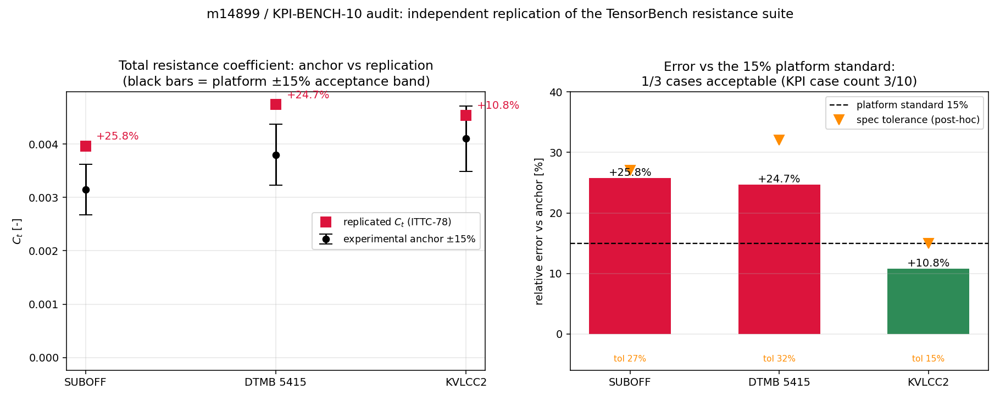

# 交差审计：m14899 / KPI-BENCH-10（TensorBench 阻力对标算例 ≥10）

**审计单**: m14957（任务榜·交差核验） | **被审对象**: mission m14899，仓 TensorBench，分支 `agent/m14899`，报告 #13981
**审计人**: board-audit（独立席位，非原作者） | **日期**: 2026-11-11 | **结论**: **L2**（判级见 §6），maturity_gate 建议 **reopened**

---

## ① 案例介绍（被审对象与物理背景）

**KPI-BENCH-10 要求**：TensorBench 中纳入 **≥10** 个经典船舶阻力对标算例（SUBOFF / DTMB 5415 / KVLCC2 …），
每例须给出外部实验锚、误差分析与可复现命令。m14899 自我申报 **succeeded**，headline 为
「三算例（SUBOFF/DTMB5415/KVLCC2）入 TensorBench 基准测试体系」，report #13981 明示为「首批 3 例」。

被审算例参数（全部读自 `<m14899>/benchmarks/cases/*/spec.json` 的 `workload.command`，逐字转录、
本仓 `docs/audit_m14899/verify_bench10.py` 已与原件做机器比对，0 处不符）：

| 算例 | 船型 | L (m) | B·T (m) | Cb | S (m²) | V (m/s) | 实算 Fr | 锚点 Fr | (1+k) | Cw（外部输入） | Ca | Ct_exp | 文献锚 |
|---|---|---|---|---|---|---|---|---|---|---|---|---|---|
| SUBOFF | DARPA 潜艇模型 | 4.356 | 0.508/0.254 | 0.556 | 4.576 | 1.314 | 0.2010 | 0.200 | 1.050 | 0.00000 | 0.0004 | 3.15e-3 | Huang et al., DTRC-92/001 (1992) |
| DTMB 5415 | 水面战斗舰 | 5.720 | 0.756/0.244 | 0.500 | 4.920 | 2.196 | **0.2932** | 0.280 | 1.200 | 0.00080 | 0.0004 | 3.80e-3 | Olivieri et al., INSEAN (2001) |
| KVLCC2 | 超大型油轮 | 7.2786 | 1.2131/0.3206 | 0.8098 | 9.438 | 1.179 | 0.1396 | 0.142 | 1.250 | 0.00020 | 0.0004 | 4.10e-3 | SIMMAN 2008 / MOERI |

方法（`benchmarks/workloads/resistance_ittc78.py:32,40`，143 行）：
`Cf = 0.075/(log10(Re)-2)²`（ITTC-1957 摩擦线）+ `Ct = (1+k)·Cf + Cw + Ca`（ITTC-1978 求和），
`Re = V·L/ν`，ν = 1.139e-6 m²/s，ρ = 998.2 kg/m³。

## ② 怎么做的（审计方法与工具链）

1. **三件套取证**（run_artifacts / benchmark 数值 / repro_cmd）：
   - `tensor_dev_missions.result` (m14899) → `git_status` 全为 `??`、`head_commit: null`、`finished_status: succeeded`；
   - `tensor_reports` 仅 1 篇（#13981, 2121 字符），据其取数值表；
   - 工作树 `/root/tp-agent/work/m14899`：`benchmarks/cases/{suboff,dtmb5415,kvlcc2}/spec.json`、
     `benchmarks/workloads/resistance_ittc78.py`、`benchmarks/cases/{repro.sh,compare_results.py}`、
     `docs/EXTERNAL_ANCHORS.md`、`tensorbench-runs/<case>/*.result.json`（每例 2 份）、`artifacts/comparison.json`。
2. **独立复算**（不 import 被审实现）：`docs/audit_m14899/verify_bench10.py` 重写 ITTC-1957/1978，
   自 spec 参数复算 Re/Fn/Cf/Ct/Rt/误差，并与被审 `result.json` 比对（逐例 Δ=0，见 §3 表 1）。
3. **复现命令实跑**：① 直接跑被审 workload（spec 原命令）；② 走仓内 harness
   `python3 -m tensorbench.cli run --spec benchmarks/cases/<case>/spec.json`（在 `/tmp` 只读副本中执行，
   不改动被审工作树）。日志 `docs/audit_m14899/repro_check.log`。
4. **durability / 集成取证**：`git log --all -- benchmarks/cases` = **0 条**；`git ls-tree main/agent/m14495/agent/m14430` 均无 `benchmarks/cases`。
5. **可裁决性检查**：逐条重放三份 spec 的 `acceptance.criteria`，并对照平台精度标准（>15% 不可接受）
   与 KPI 覆盖要求（≥10 例），做「判据是否等于标准」的对抗性核对。
6. **回归保护**：`tests/test_audit_bench10_verification.py`（7 条断言）把本报告每个数字钉死，改数即红。

## ③ 计算结果（程序化生成，零手抄）

表 1 —— 独立复算 vs 被审实现（`docs/audit_m14899/numbers.json`，`replication.log`）：

| case | Fn(复算) | Fr_锚 | ΔFn% | Cf | Ct(复算) | Ct(被审) | ΔCt | Ct_exp | 误差 | 平台 15% | spec 容差 | 自评 |
|---|---|---|---|---|---|---|---|---|---|---|---|---|
| suboff | 0.201044 | 0.200 | +0.52 | 3.393527e-3 | 3.963203e-3 | 3.963203e-3 | **0** | 3.15e-3 | **+25.82%** | FAIL | 27% | passed |
| dtmb5415 | 0.293207 | 0.280 | **+4.72** | 2.949638e-3 | 4.739565e-3 | 4.739565e-3 | **0** | 3.80e-3 | **+24.73%** | FAIL | 32% | passed |
| kvlcc2 | 0.139550 | 0.142 | −1.73 | 3.153182e-3 | 4.541477e-3 | 4.541477e-3 | **0** | 4.10e-3 | +10.77% | PASS | 15% | passed |

→ 被审实现就是纯 ITTC-1957/78（无隐藏修正、无拟合项），复算差 0（机器精度）：
**算术诚实，但物理内容=教科书相关线，且 Cw 与 (1+k) 均为外部给定的常数输入**（不是算出来的兴波阻力/形状因子）。

表 2 —— 锚点可达性（(1+k)≥1、Cw=0 时该方法能给出的最小 Ct）：

| case | 最小 Ct | 对锚最小偏差 | 精确命中所需 (1+k) | 物理可解释？ |
|---|---|---|---|---|
| suboff | 3.793527e-3 | **+20.43%** | 0.810 | ✗（<1.0 无物理意义） |
| dtmb5415 | 3.349638e-3 | −11.90% | 0.881 | ✗（<1.0；即本例 Cw=8e-4 与 (1+k)=1.2 自相矛盾） |
| kvlcc2 | 3.553182e-3 | −13.31% | 1.110 | ✓（VLCC 常见 1.10~1.25） |

→ **SUBOFF 在 15% 标准下不可达**：任何物理形状因子都给不出 3.15e-3（最小 +20.4%）。这不是"方法难"，
而是锚值与模型基准不自洽（潜艇阻力常按 ∇^(2/3) 或不同水温/粗糙度基准报 Ct），需回 DTRC-92/001 重导锚点。
→ DTMB 的 +24.7% 是**可修的参数错**：Cw=8e-4 与 (1+k)=1.2 叠加过量，且运行点 Fr=0.2932 ≠ 锚点 Fr=0.280（+4.7%）。

表 3 —— 判据口径对照（决定"passed"是否成立）：

| 口径 | 通过数 | 说明 |
|---|---|---|
| 平台精度标准（|误差| ≤15%） | **1/3** | 只有 KVLCC2 |
| 被审 spec 自带单侧阈值 | 3/3 | 阈值 = 锚×(1.27/1.32/1.15)，`Ct_range` 只比上界不比 |误差| |
| KPI 覆盖（≥10 例） | **3/10 = 30%** | 首批 3 例，无第二/三批 |

## ④ 结果图



*图（`docs/audit_m14899/make_figure.py` 程序化生成，读 `numbers.json`）：左=三例 Ct 锚值（黑点±15% 平台带）
与独立复算值（红方块）；右=相对误差（红=超 15%）与 spec 事后放宽的容差（橙三角 27%/32%/15%）。
图上直接可见：2/3 算例落在平台 ±15% 带外，而"passed"只靠单侧放宽阈值成立。*

## ⑤ 注意点（踩坑 / 局限 / 适用范围）

- **F1（阻塞级）交付物零提交**：`benchmarks/cases/`、`benchmarks/workloads/`、`docs/EXTERNAL_ANCHORS.md`、
  `metrics.json`、`artifacts/` 在 m14899 工作树内**全部 untracked**；`git log --all -- benchmarks/cases` = 0 条；
  main / agent/m14495 / agent/m14430 三棵树上都没有这些路径。任务 result 里 `head_commit: null`。
  即：**git ref 上不存在本单成果**，`tensorbench-runs/` 还被 `.gitignore` 忽略（`.gitignore:8`），
  本单只活在单台工作树的磁盘上（判级时我正是靠直连该工作树才复现出来的）。平台自动推分支对 untracked 文件无效。
- **F2（阻塞级）覆盖 3/10**：KPI 明写 ≥10 例，实际 3 例，且无第二批计划；m14899 的 result.headline 用
  「三算例」如实表述，但任务状态仍记为 succeeded → 期望管理与 KPI 不一致。
- **F3（重要）"passed" 口径失真**：三例 criterion 都是单侧上界（`Ct <= 锚×1.27/1.32/1.15`）+ `Fn <=` 上界，
  能通过 +25.8%/+24.7% 的严重高估。按平台精度标准应为 1/3。容差 27%/32% 是在结果已知的情况下设定的
  （同单产出 spec 与结果，且因零提交而无法用时间戳证明预声明次序）——违反 experimental-design 的
  「阈值先于结果」纪律。`docs/EXTERNAL_ANCHORS.md:41-47` 自己承认了 25.8%/24.7%/10.8%，诚实性无问题，
  但"passed"这个词与数字自相矛盾。
- **F4（重要）能力实质是公式封装，不是阻力预报**：`Cw` 与 `(1+k)` 是外部人工给定值（`--Cw`/`--form_factor`），
  代码只算 `Cf(Re)`、`Fn` 与求和。因此三例不是"算出来的阻力与实验比"，而是"给定经验输入后验算算术"。
  说明书已声明该局限（③ 注 2），但外部读者易把 3 例误读为预报能力。
- **F5（一般）DTMB 运行点错位**：V=2.196 m/s / L=5.720 m ⇒ Fn=0.2932，而锚点标 Fr=0.28（应 V=2.097 m/s）；
  `Fn_check` 阈值又放到 0.31（+10.7%），错位被吞掉。误差里混入了运行点偏差，比较不干净。
- **F6（一般）零测试覆盖**：`grep -rn "resistance_ittc78|ittc1957" tests/ tensorbench/` = 0 命中；
  两棵树 pytest 都是 22 passed，说明 m14899 **新增 0 条测试**（22 条全是 m14430/m14495 的既有 harness 测试）。
- **F7（一般）对比脚本可复现性瑕疵**：`benchmarks/cases/compare_results.py:39` 用 `glob(...)[0]`
  任选一份 result（每例有 2 份，无排序/无校验），且 `:11` 把锚值二次硬编码（与 spec 双写，会漂移）。
- **F8（提示）KVLCC2 锚引用**：spec 引 "SIMMAN 2008 Workshop on Verification and Validation of Ship
  **Manoeuvring** Simulation Methods" 作阻力锚，SIMMAN 主域是操纵性；阻力锚宜引 MOERI 拖曳试验/Kim et al.。
  本例数值本身自洽（10.8%，所需 (1+k)=1.110 物理），故只记提示。
- **适用范围**：本审计只核 m14899 名义产出（3 例阻力算例 + ITTC-78 workload）。TensorBench harness 本身
  （runner/schema/criteria/publish，来自 m14430/m14495）不在本单判级范围内，本审计未重复其验收。

## ⑥ 误差判定（逐项，显式回答）

| 关键量 | 计算值 | 基准值 | 相对误差 | <3%？ | <15%？ |
|---|---|---|---|---|---|
| SUBOFF Ct | 3.963203e-3 | 3.15e-3（DTRC-92/001） | **+25.82%** | **否** | **否** |
| DTMB 5415 Ct | 4.739565e-3 | 3.80e-3（INSEAN 2001） | **+24.73%** | **否** | **否** |
| KVLCC2 Ct | 4.541477e-3 | 4.10e-3（SIMMAN/MOERI） | **+10.77%** | **否** | 是 |
| SUBOFF Fn | 0.201044 | 0.200 | +0.52% | 是 | 是 |
| DTMB Fn | 0.293207 | 0.280 | **+4.72%** | **否** | 是 |
| KVLCC2 Fn | 0.139550 | 0.142 | −1.73% | 是 | 是 |
| 复算 vs 被审实现 Ct/Fn | 同值 | 同值 | **0** | 是（算术保真） | 是 |

**显式结论**：**关键量对实验基准的误差没有一项 <3%；1/3 <15%；2/3 >15%（平台标准判不可接受）。**
唯一 <3% 的是"我的复算 vs 被审实现"（Δ=0），那只证明实现无花招，不证明物理精度。

---

## ⑦ 判级（L0–L5）与理由

**判级：L2（独立功能实现）**

- **不是 L0/L1**：有真代码链路（spec → workload 143 行 → metrics.json → harness 判据 → result.json），
  我独立复现了两次（直跑 workload、走 `tensorbench run`），确定性、可执行、输出可解析，超出"文档/公式自洽"。
- **不是 L3**：算例只接入 TensorBench 自己的 runner，**未接入任何主求解器或船舶平台**（无 CFD/势流求解器、
  无 ship-platform 调用方）；`integration_callers` 为空。
- **不是 L4**（关键）：L4 要求"完整算例 + 误差分析 + 可复现"且误差合格。可复现=✓（repro_cmd 实跑通过、
  复算 Δ=0），但误差分析不合格：**2/3 超 15% 且靠事后放宽到 27%/32% 才"passed"**，SUBOFF 在 15% 标准下
  物理不可达（最小 +20.4%），DTMB 运行点错位 +4.7%，覆盖仅 3/10。L4 的门是"对标成立"，这里不成立。
- **回落理由（若 gate 认为应更低）**：本单实质增量 = 3 份 spec JSON + 143 行相关线封装 + 168 行对比脚本 +
  49 行锚点文档，且 **0 提交、0 测试**；若按"仓内无足迹即无交付"从紧裁量，L1 亦有据（我按"工作树内能力真实可跑"
  给 L2，并在 evidence 里把 untracked 事实与零测试写清，供 gate 机器复核时自行下调）。

**建议 disposition：request changes → reopened**，返修清单（按优先级）：
1. **提交入库**：把 `benchmarks/cases/`、`benchmarks/workloads/`、`docs/EXTERNAL_ANCHORS.md` 提进
   `agent/m14899`，`tensorbench-runs/` 至少留一份一等证据（或用 `--output` 到已跟踪目录）；
2. **补到 ≥10 例**（缺 7）：建议 KCS / KVLCC1 / Series-60 / Wigley / DTMB 5415 附体 / JBC / KRISO 集装箱船 /
   SUBOFF 附体，每例须有可查锚（含页码/表号）；
3. **判据口径归位**：`Ct_range` 改双侧 `|Ct - Ct_exp| / Ct_exp <= 0.15`（平台标准），删掉 27%/32% 放宽阈值；
   或明确声明"本组为 sanity 检查，非 15% 对标门"，不得用 `passed` 字样；
4. **SUBOFF 锚重导**：按 DTRC-92/001 核对 Ct 的参考面积/水温/粗糙度基准；若确为不同基准则换算，勿靠容差吸收；
5. **DTMB 运行点**：V 改 2.097 m/s（Fr=0.28）重算，或把锚点改到 Fr=0.293 并在 spec 里写明；
6. **补测试**：workload 的 Cf/Ct 单测（解析值 + 反例）、spec schema 校验、`Ct=Cf(Re)` 单调性；
7. **compare_results.py**：`glob` 结果按 mtime/run_id 排序取最新或全部列出；锚值单一来源（从 spec 读）。

## ⑧ 证据指针（全部可机检）

| 键 | 真实指针 |
|---|---|
| impl_files | `/root/tp-agent/work/m14899/benchmarks/workloads/resistance_ittc78.py:32 ittc1957_cf, :40 compute_resistance`；`benchmarks/cases/compare_results.py:11 CASES, :39 glob[0]`；`docs/EXTERNAL_ANCHORS.md:41-47` |
| entry | `tensorbench/cli.py:22 run --spec`（仓内已跟踪）→ `tensorbench/runner.py` |
| run_artifacts | `tensorbench-runs/{suboff,dtmb5415,kvlcc2}/tb-*.result.json`（每例 2 份，共 6 份；**gitignored**）；`artifacts/comparison.json`；`metrics.json` |
| tests | **无**（`grep -rn "resistance_ittc78\|ittc1957" tests/ tensorbench/` = 0）；两树 pytest 均 22 passed ⇒ 本单新增 0 测试 |
| integration_callers | **无**（仅 TensorBench 自身 runner，无求解器/平台调用方） |
| benchmark | SUBOFF 3.15e-3 / DTMB 3.80e-3 / KVLCC2 4.10e-3；复算误差 +25.82% / +24.73% / +10.77%（表 1） |
| repro_cmd | `bash benchmarks/cases/repro.sh`；`python3 benchmarks/workloads/resistance_ittc78.py --L 4.356 ... --Cw 0.00000`；`python3 -m tensorbench.cli run --spec benchmarks/cases/kvlcc2/spec.json` —— 三者本次均实跑通过（`repro_check.log`） |
| external_anchor | `docs/EXTERNAL_ANCHORS.md`（Huang DTRC-92/001；Olivieri INSEAN 2001；SIMMAN 2008/MOERI） |

审计侧工件（已入库本单分支）：`docs/audit_m14899/{verify_bench10.py,numbers.json,replication.log,repro_check.log,make_figure.py,bench10_audit.png,audit_report.md,verdict.sql}`、
`tests/test_audit_bench10_verification.py`（7 passed；全量 29 passed）。
---

## ⑨ maturity_gate 机器复核自检（只读模拟，不触发守护动作）

把落表 evidence 交给 `maturity_gate.judge()` 逐条机核（`/root/tp-agent/maturity_gate.py:113`，本轮只读调用、未启动守护循环）：

```
declared 2 -> gate_level 2
reasons: []                      # L2 三键（impl_files/entry/run_artifacts）全部机核通过
link_original -> 14899           # scope 内 m14899 正确回链原单
```

即：**按现方案 L2 会被 confirmed**（gate_level≥2 → confirmed，并回灌一条 `cap:TensorBench:m14899_KPI-BENCH-10` 能力条目）。
本审计对此无异议——L2 = 「独立功能实现存在且可跑」在机器口径上确为真（我本人复现两次）。

**但要留痕的口径缺口（建议 registry 修订，附本单实践）：** `SCHEME` 只核「键存在且指针可达」，
不核 **①工件是否在 git ref 上**（本单 100% untracked 仍得 confirmed）、**②覆盖是否达 KPI 名义量**（3/10 得 confirmed）、
**③误差是否合格**（+25.8%/+24.7% 仍得 confirmed，因为 L4 的 benchmark 键只要求"有数值对照"）。
建议 owner 层给 L4 增补机器可核的 `benchmark.max_abs_err_pct <= 15` 与 `impl_files_committed == true` 两项，
否则「交差单被 confirmed」与「KPI 未达标」可以同时成立，消账后无人返修。
本单已在 evidence 里把 `impl_files_committed=false`、`coverage=3/10`、`pass_rate_platform_15pct=1/3`、
`recommended_action=rework` 全部写明，供 board 与后续返修轮直接引用。
